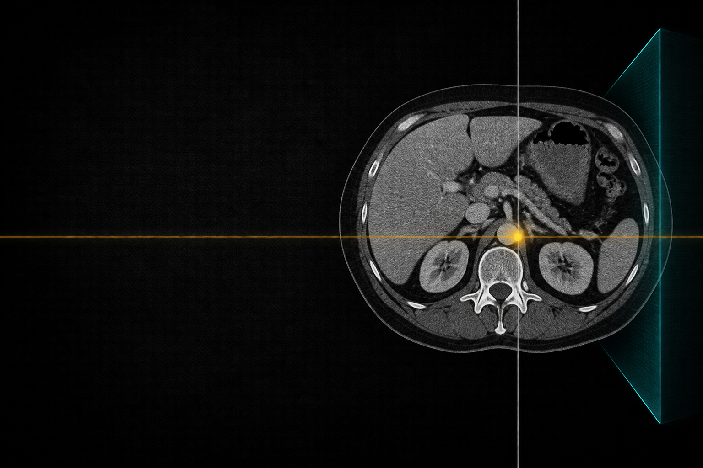
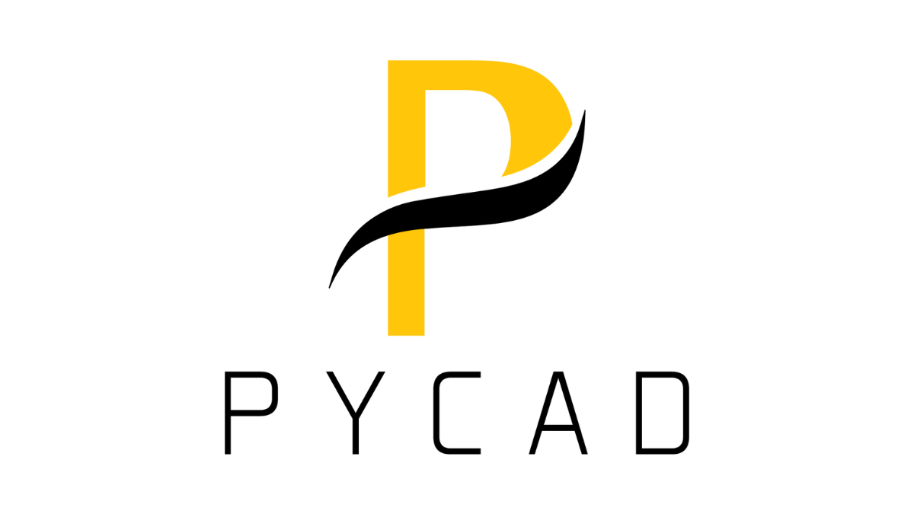

  

<h1 align="center">Mohammed El Amine Mokhtari</h1>

  Co-founder &amp; tech lead at <a href="https://pycad.co">PYCAD</a>
  · building <a href="https://paplyn.com">Paplyn</a> 
  Medical imaging platforms · DICOM viewers · AI segmentation · clinical reporting

  
  &nbsp;&nbsp;&nbsp;&nbsp;&nbsp;&nbsp;&nbsp;
  <a href="https://paplyn.com"> <strong style="font-family: 'Newsreader', 'Source Serif 4', Georgia, 'Times New Roman', serif; font-size: 28px; vertical-align: middle;">Paplyn</strong></a>

I build the stack clinics run on: custom DICOM viewers (MPR, 3D, annotations, PACS), AI that sits inside those viewers, and the reporting / case layer around the images. Work spans dentistry, orthopedics, forensic, and radiology. PhD research at UMONS (ISIA Lab).

## Imaging, AI, reporting

- **Imaging** — DICOM, NIfTI, NRRD, STL/PLY, DICOM-SEG. Viewers built for the domain, not a generic PACS skin.
- **AI** — segmentation and measurements in the same workspace as the scan.
- **Reporting** — cases, CRM, and LLM-assisted report generation on top of the images.

More: [pycad.co](https://pycad.co)

## Selected public work

**Personal**
- [Liver Segmentation with MONAI](https://github.com/amine0110/Liver-Segmentation-Using-Monai-and-PyTorch) — 3D liver segmentation in PyTorch / MONAI. ★234
- [SAM for Medical Imaging](https://github.com/amine0110/SAM-Medical-Imaging) — Segment Anything on medical images. ★119
- [nifti2dicom](https://github.com/amine0110/nifti2dicom) — NIfTI → DICOM. ★61
- [pycad](https://github.com/amine0110/pycad) — medical imaging notebooks and utilities. ★54
- [Medical-Conversions](https://github.com/amine0110/Medical-Conversions) — convert between medical and standard image formats. ★40
- [Spine segmentation (nnU-Net)](https://github.com/amine0110/spine-segmentation-nnunet) — nnU-Net spine training/inference. ★30

**PYCAD** ([pycadd](https://github.com/pycadd))
- [pycad-model-zoo](https://github.com/pycadd/pycad-model-zoo) — nnU-Net models for body-part segmentation. ★21
- [YouTube-Tutorials](https://github.com/pycadd/YouTube-Tutorials) — code from PYCAD videos. ★14
- [python-for-medical-imaging](https://github.com/pycadd/python-for-medical-imaging) — teaching material. ★6

  <a href="https://pycad.co">Website</a> ·
  <a href="https://www.youtube.com/channel/UCdYyILlPlehK4fKS5DiuMXQ">YouTube</a> ·
  <a href="https://www.linkedin.com/in/mohammed-el-amine-mokhtari-5729a2115/">LinkedIn</a>

