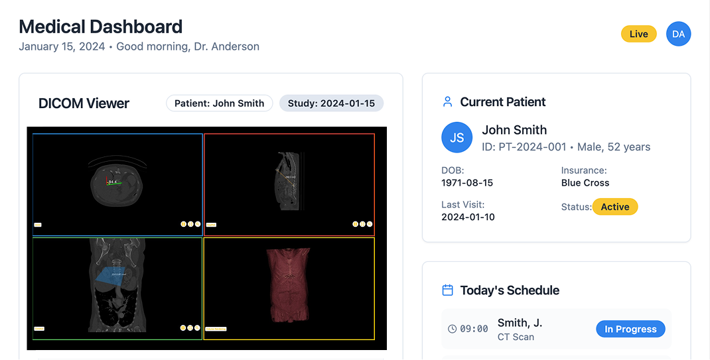
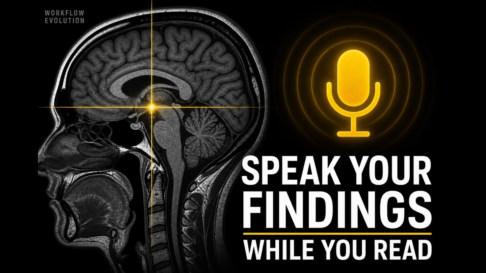
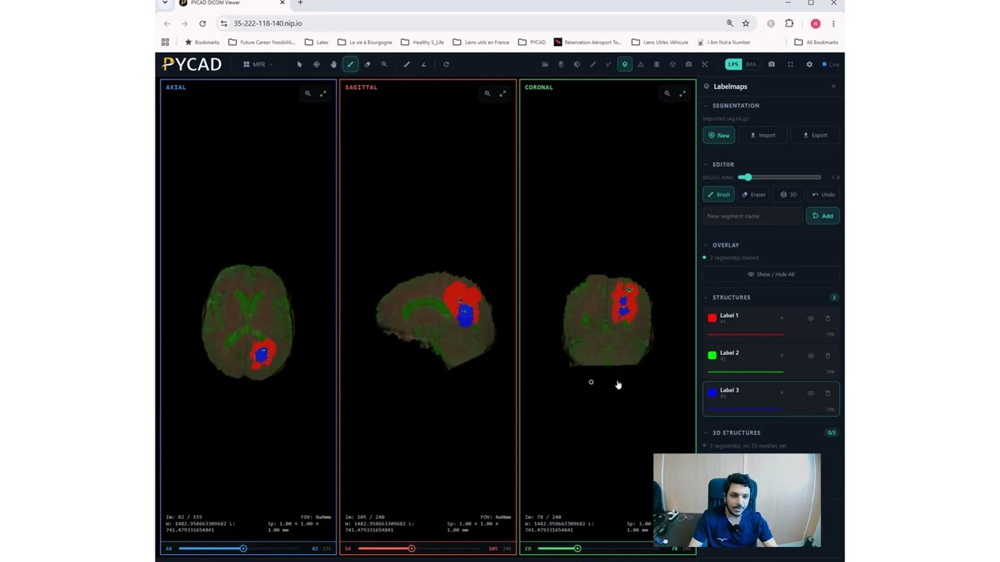
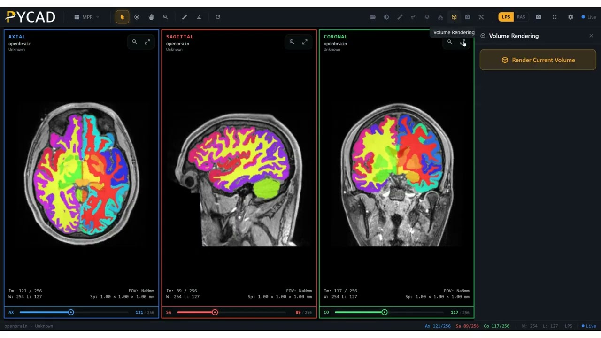

  

Hey. I'm Amine. I build medical imaging products at [PYCAD](https://pycad.co) — DICOM viewers, segmentation, the reporting around the scan. Also [Paplyn](https://paplyn.com). PhD at UMONS.

  
  
  
  
  

  

### On the bench

Custom web DICOM viewers with MPR, 3D, overlays, and the case layer around them.

  

### Latest on YouTube

<table>
  <tr>
    <td width="33%" valign="top">
       
      <a href="https://www.youtube.com/watch?v=BxjX16E5Ha0">Speak findings while you read</a>
    </td>
    <td width="33%" valign="top">
       
      <a href="https://www.youtube.com/watch?v=_nUba07Q7HI">MRI segmentation in a web viewer</a>
    </td>
    <td width="33%" valign="top">
       
      <a href="https://www.youtube.com/watch?v=1Sd8vuYf_WA">Neuro viewer, overlays, 3D</a>
    </td>
  </tr>
</table>

[All videos](https://www.youtube.com/channel/UCdYyILlPlehK4fKS5DiuMXQ)

### Writing

Recent notes on [pycad.co/blog](https://pycad.co/blog/):

- [CoM3eT lifts breast MRI Dice 0.25 → 0.59](https://pycad.co/blog/comet-pyramid-transformer-lifts-breast-mri-dice/) — 25 Aug 2026
- [MedSAM3 LoRA, gallbladder Dice 0.0003 → 0.68](https://pycad.co/blog/ten-case-medsam3-lora-recovers-gallbladder-dice/) — 25 Aug 2026
- [MedSAM2-Anatomy, hip MRI 0.71 → 0.92](https://pycad.co/blog/medsam2-anatomy-recovers-hip-mri-dice-without-retraining/) — 24 Aug 2026
- [SAT3D uncertainty-guided tumour seg in 3D Slicer](https://pycad.co/blog/sat3d-uncertainty-guided-tumour-segmentation-3d-slicer/) — 23 Aug 2026

### Open code

